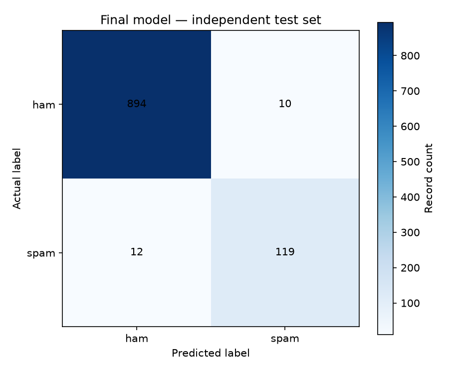

# Final SMS Spam Classifier — Independent Test Evaluation

## Selected model and justification

The selected candidate is **TF-IDF + Logistic Regression with
`class_weight="balanced"`**. It was chosen provisionally using training-only
out-of-fold threshold selection and exploratory validation results in
`reports/model_comparison_report.md`. No competing model was evaluated on the
test set, and no model or threshold decisions were changed after test
evaluation.

## Training dataset

- Source: `data/processed/train.csv`
- Records used for final fitting: **4,136**
- Class counts: ham=3,614,
  spam=522
- SHA-256: `240b431cce84f594afd2fd7c5e8e40d37d52bab7fca4a9d87984a02004950624`
- The complete training dataset was used to fit the final pipeline.

## Decision threshold

- Threshold: **0.5434265976102519**
- Origin: Task 07 manifest key
  `candidates.logistic_regression_balanced.oof_selected_thresholds.OOF best F1`.
- This probability threshold was selected using 5-fold stratified
  out-of-fold predictions on the Task 07 model-training subset only. It was
  not selected or adjusted using test labels.

## Test dataset and independent evaluation

- Source: `data/processed/test.csv`
- Records evaluated: **1,035**
- Class counts: ham=904,
  spam=131
- SHA-256: `9723dff62c6f45a39a01b5a784a1442211e2a145b9895977f4bed8b86f629ac4`
- Test labels were used once for the evaluation below. The test data was not
  passed to `fit`, used to choose the threshold, or used to change
  configuration.
- Positive class: **spam**

## Test metrics

| Metric | Independent test result |
|---|---:|
| Accuracy | 0.9787 |
| Spam precision | 0.9225 |
| Spam recall | 0.9084 |
| Spam F1-score | 0.9154 |
| Macro F1-score | 0.9516 |
| Average Precision (PR-AUC summary) | 0.9618 |
| ROC-AUC | 0.9891 |
| False positives | 10 |
| False negatives | 12 |

### Confusion matrix

Rows are actual labels; columns are predicted labels.

| Actual \ Predicted | ham | spam |
|---|---:|---:|
| ham | 894 | 10 |
| spam | 12 | 119 |



### Classification report

```text
              precision    recall  f1-score   support

         ham     0.9868    0.9889    0.9878       904
        spam     0.9225    0.9084    0.9154       131

    accuracy                         0.9787      1035
   macro avg     0.9546    0.9487    0.9516      1035
weighted avg     0.9786    0.9787    0.9787      1035
```

## False-positive and false-negative analysis

- **False positives (10):** legitimate ham messages classified as spam.
  These may be incorrectly flagged or filtered.
- **False negatives (12):** spam messages classified as ham. These are
  missed spam and are important to review when assessing the operating
  trade-off.

## Validation versus final test

The validation figures below are from exploratory Task 07 validation and are
not the independent final test result. The test column is the single
evaluation performed for this task.

| Metric | Validation (exploratory) | Final test (independent) |
|---|---:|---:|
| Accuracy | 0.9795 | 0.9787 |
| Spam precision | 0.9231 | 0.9225 |
| Spam recall | 0.9143 | 0.9084 |
| Spam F1-score | 0.9187 | 0.9154 |
| False positives | 8 | 10 |
| False negatives | 9 | 12 |

Validation and test metrics can differ because they contain different
messages. The test results are reported as measured and were not used for
further selection.

## Model configuration and saved artifacts

- Vectorizer: `TfidfVectorizer` with
  `lowercase=True`,
  `strip_accents="unicode"`,
  `ngram_range=(1, 2)`,
  `min_df=2`,
  `max_df=0.95`,
  `sublinear_tf=True`.
- Classifier: `LogisticRegression` with
  `class_weight="balanced"`,
  `max_iter=1000`,
  `random_state=42`.
- Pipeline plus threshold and metadata: `models/final/final_model.joblib`
  (Joblib serialization; bundle keys are `pipeline`, `threshold`, and
  `metadata`).
- Configuration sidecar: `models/final/model_metadata.json`.
- Model version: `1.0.0`
- Created (UTC): `2026-11-04T14:40:32.045645+00:00`

## Limitations and application-readiness

This evaluation represents one held-out sample from the same collection, not
all future SMS traffic. The dataset is historically sourced and class
imbalanced; message content and spam tactics can shift. Average Precision and
ROC-AUC summarize ranking and do not replace the chosen operating threshold.
False positives and false negatives have different costs and should be
monitored in use.

The fitted pipeline and threshold are reproducibly packaged, so the project
can proceed to application development using the documented bundle format.
Treat the model as a baseline, disclose its limitations, and avoid representing
the test result as a guarantee of real-world performance.
