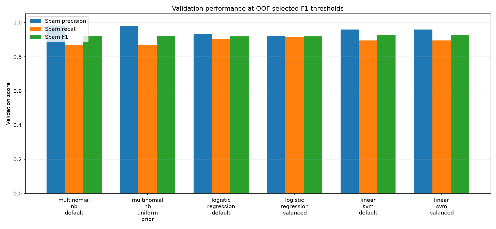
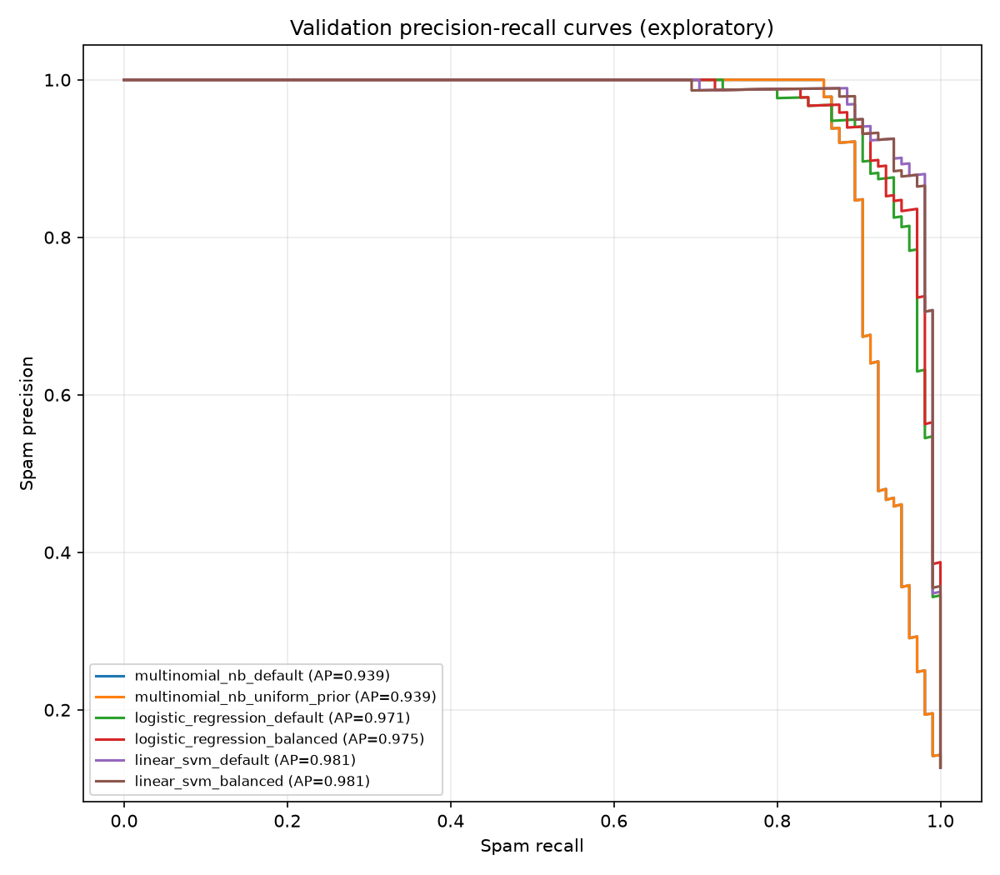
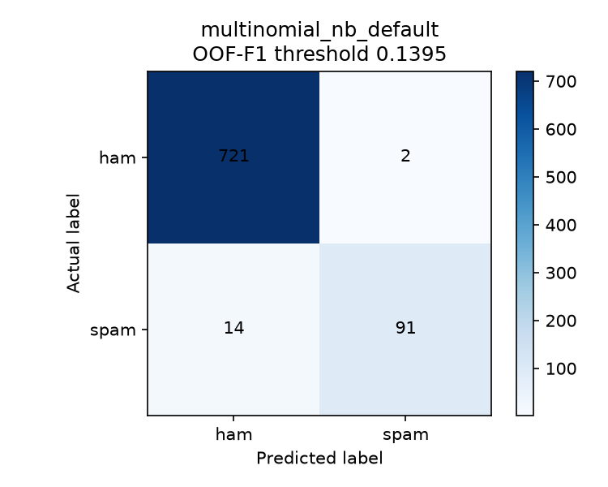
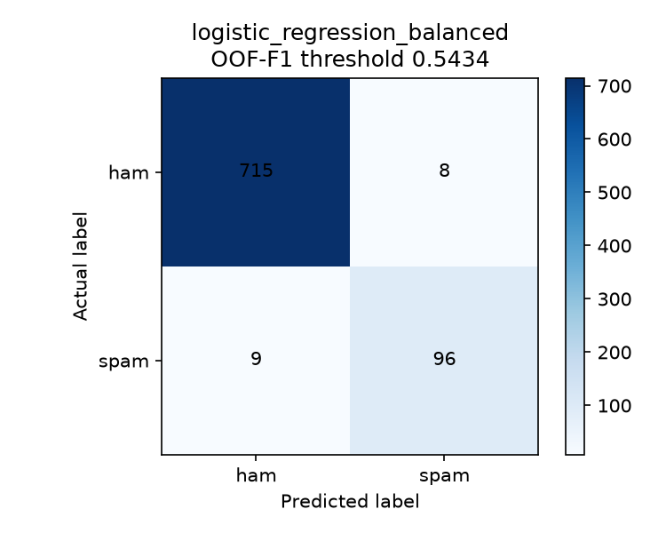

# SMS Spam Classifier — Model Comparison

## Scope and validation protocol

The saved baseline was first reproduced using the existing training/validation
split. For all new candidates, only `data/processed/train.csv` was read. It
was split once with `train_test_split(test_size=0.2, random_state=42,
stratify=y)`: **3,308** model-training records and
**828** validation records. The test file was not accessed.

Each model uses the same TF-IDF settings inside its own scikit-learn Pipeline:
`lowercase=True`, `strip_accents="unicode"`, `ngram_range=(1, 2)`,
`min_df=2`, `max_df=0.95`, and `sublinear_tf=True`. Pipelines were fit only
on the model-training subset. OOF scores from 5-fold `StratifiedKFold`
(`shuffle=True`, `random_state=42`) on that subset selected candidate
thresholds without using validation labels. Validation-based comparisons and
the charts below are exploratory and must not be interpreted as final test
performance.

Spam is the positive class. Confusion matrices use `[[TN, FP], [FN, TP]]`.
Average precision (AP), a common summary of the spam precision-recall curve,
is reported alongside ROC-AUC using continuous probability or decision scores.
AP is not a calibrated probability. Linear SVM decision values are uncalibrated
scores, not probabilities.

## Reproduced baseline

The saved `models/naive_bayes_baseline.joblib` reproduced the prior validation
result: accuracy **0.9626**, spam precision
**1.0000**, recall
**0.7048**, F1
**0.8268**, and confusion matrix
`[[723, 0], [31, 74]] (FP=0, FN=31)`. This matches the Task 06
report (rounding to 96.26% accuracy, 100% precision, 70.48% recall,
82.68% F1, and 31 false negatives).

## Model comparison

Metrics in this table use each candidate's OOF-selected best-F1 threshold,
evaluated on the validation subset. For probabilities, default prediction
threshold is 0.5; for LinearSVC, the default decision cutoff is 0.0.
Average precision and ROC-AUC are ranking metrics and do not depend on the
selected cutoff.

| Candidate | Score type | Default cutoff | OOF best-F1 cutoff | Accuracy | Spam precision | Spam recall | Spam F1 | Macro F1 | PR-AUC / AP | ROC-AUC | FP | FN | Confusion matrix |
|---|---|---:|---:|---:|---:|---:|---:|---:|---:|---:|---:|---:|---|
| `multinomial_nb_default` | probability | 0.5 | 0.139492 | 0.9807 | 0.9785 | 0.8667 | 0.9192 | 0.9541 | 0.9388 | 0.9701 | 2 | 14 | `[[721, 2], [14, 91]] (FP=2, FN=14)` |
| `multinomial_nb_uniform_prior` | probability | 0.5 | 0.528878 | 0.9807 | 0.9785 | 0.8667 | 0.9192 | 0.9541 | 0.9388 | 0.9701 | 2 | 14 | `[[721, 2], [14, 91]] (FP=2, FN=14)` |
| `logistic_regression_default` | probability | 0.5 | 0.241603 | 0.9795 | 0.9314 | 0.9048 | 0.9179 | 0.9531 | 0.9714 | 0.9932 | 7 | 10 | `[[716, 7], [10, 95]] (FP=7, FN=10)` |
| `logistic_regression_balanced` | probability | 0.5 | 0.543427 | 0.9795 | 0.9231 | 0.9143 | 0.9187 | 0.9535 | 0.9745 | 0.9943 | 8 | 9 | `[[715, 8], [9, 96]] (FP=8, FN=9)` |
| `linear_svm_default` | decision_function | 0 | -0.0574289 | 0.9819 | 0.9592 | 0.8952 | 0.9261 | 0.9579 | 0.9812 | 0.9954 | 4 | 11 | `[[719, 4], [11, 94]] (FP=4, FN=11)` |
| `linear_svm_balanced` | decision_function | 0 | 0.047752 | 0.9819 | 0.9592 | 0.8952 | 0.9261 | 0.9579 | 0.9806 | 0.9954 | 4 | 11 | `[[719, 4], [11, 94]] (FP=4, FN=11)` |

## Class weighting and prior effects

Logistic Regression and LinearSVC are each compared with default
`class_weight=None` and `class_weight="balanced"`. The default-cutoff effects
observed on validation were:

- **Naive Bayes prior (default cutoff 0.5):** learned priors (precision 1.0000, recall 0.7048, F1 0.8268, FP 0, FN 31); uniform priors (precision 0.9479, recall 0.8667, F1 0.9055, FP 5, FN 14). The uniform prior reduced false negatives on this validation set while increasing false positives.
- **Logistic Regression (default cutoff 0.5):** unweighted (precision 0.9877, recall 0.7619, F1 0.8602, FP 1, FN 25); balanced weights (precision 0.9143, recall 0.9143, F1 0.9143, FP 9, FN 9). Balanced weights increased spam recall and reduced false negatives here, with a precision/false-positive trade-off.
- **LinearSVC (default score cutoff 0.0):** unweighted (precision 0.9691, recall 0.8952, F1 0.9307, FP 3, FN 11); balanced weights (precision 0.9500, recall 0.9048, F1 0.9268, FP 5, FN 10). The change was modest on this validation set; it did not improve every metric.
- At OOF-selected F1 cutoffs, compare the comparison table: Logistic Regression weighting changed precision/recall/F1/FN from precision 0.9314, recall 0.9048, F1 0.9179, FP 7, FN 10 to precision 0.9231, recall 0.9143, F1 0.9187, FP 8, FN 9. OOF threshold selection can change the class-weight effect relative to the estimator's default cutoff.

MultinomialNB's `fit_prior=False` candidate uses uniform class priors and is
compared with the learned-prior baseline (`fit_prior=True`). The results are
split-dependent: balanced weights or uniform priors are not assumed to be
superior, and no setting is selected based on accuracy alone.

## Threshold experiments

For probability-producing candidates, the threshold tables include the
requested validation experiment cutoffs 0.20, 0.30, 0.40, 0.50, 0.60, and
0.70. These rows use validation labels and are exploratory, not threshold
selection evidence. OOF-selected F1 and recall-target thresholds are also
listed; those thresholds were chosen using OOF model-training-subset labels,
then evaluated on validation.

For LinearSVC, the corresponding values are decision-function cutoffs, which
may be negative or positive and are not calibrated probabilities. Its default
cutoff is 0.0. OOF F1-maximizing and OOF recall-at-least-0.80/0.90 cutoffs are
shown and then evaluated on validation.

### `multinomial_nb_default` (probability)

| Threshold | Precision | Recall | F1 | FP | FN | Confusion matrix (TN, FP; FN, TP) |
|---|---:|---:|---:|---:|---:|---|
| Default (0.5) | 1.0000 | 0.7048 | 0.8268 | 0 | 31 | `[[723, 0], [31, 74]] (FP=0, FN=31)` |
| OOF best F1 (0.139492) | 0.9785 | 0.8667 | 0.9192 | 2 | 14 | `[[721, 2], [14, 91]] (FP=2, FN=14)` |
| OOF recall >= 0.80 (0.259338) | 1.0000 | 0.8286 | 0.9062 | 0 | 18 | `[[723, 0], [18, 87]] (FP=0, FN=18)` |
| OOF recall >= 0.90 (0.102908) | 0.9200 | 0.8762 | 0.8976 | 8 | 13 | `[[715, 8], [13, 92]] (FP=8, FN=13)` |
| Validation experiment (0.20) | 1.0000 | 0.8571 | 0.9231 | 0 | 15 | `[[723, 0], [15, 90]] (FP=0, FN=15)` |
| Validation experiment (0.30) | 1.0000 | 0.8190 | 0.9005 | 0 | 19 | `[[723, 0], [19, 86]] (FP=0, FN=19)` |
| Validation experiment (0.40) | 1.0000 | 0.7619 | 0.8649 | 0 | 25 | `[[723, 0], [25, 80]] (FP=0, FN=25)` |
| Validation experiment (0.50) | 1.0000 | 0.7048 | 0.8268 | 0 | 31 | `[[723, 0], [31, 74]] (FP=0, FN=31)` |
| Validation experiment (0.60) | 1.0000 | 0.6476 | 0.7861 | 0 | 37 | `[[723, 0], [37, 68]] (FP=0, FN=37)` |
| Validation experiment (0.70) | 1.0000 | 0.6000 | 0.7500 | 0 | 42 | `[[723, 0], [42, 63]] (FP=0, FN=42)` |
### `multinomial_nb_uniform_prior` (probability)

| Threshold | Precision | Recall | F1 | FP | FN | Confusion matrix (TN, FP; FN, TP) |
|---|---:|---:|---:|---:|---:|---|
| Default (0.5) | 0.9479 | 0.8667 | 0.9055 | 5 | 14 | `[[718, 5], [14, 91]] (FP=5, FN=14)` |
| OOF best F1 (0.528878) | 0.9785 | 0.8667 | 0.9192 | 2 | 14 | `[[721, 2], [14, 91]] (FP=2, FN=14)` |
| OOF recall >= 0.80 (0.708632) | 1.0000 | 0.8286 | 0.9062 | 0 | 18 | `[[723, 0], [18, 87]] (FP=0, FN=18)` |
| OOF recall >= 0.90 (0.443451) | 0.9200 | 0.8762 | 0.8976 | 8 | 13 | `[[715, 8], [13, 92]] (FP=8, FN=13)` |
| Validation experiment (0.20) | 0.5419 | 0.9238 | 0.6831 | 82 | 8 | `[[641, 82], [8, 97]] (FP=82, FN=8)` |
| Validation experiment (0.30) | 0.7540 | 0.9048 | 0.8225 | 31 | 10 | `[[692, 31], [10, 95]] (FP=31, FN=10)` |
| Validation experiment (0.40) | 0.9038 | 0.8952 | 0.8995 | 10 | 11 | `[[713, 10], [11, 94]] (FP=10, FN=11)` |
| Validation experiment (0.50) | 0.9479 | 0.8667 | 0.9055 | 5 | 14 | `[[718, 5], [14, 91]] (FP=5, FN=14)` |
| Validation experiment (0.60) | 1.0000 | 0.8571 | 0.9231 | 0 | 15 | `[[723, 0], [15, 90]] (FP=0, FN=15)` |
| Validation experiment (0.70) | 1.0000 | 0.8381 | 0.9119 | 0 | 17 | `[[723, 0], [17, 88]] (FP=0, FN=17)` |
### `logistic_regression_default` (probability)

| Threshold | Precision | Recall | F1 | FP | FN | Confusion matrix (TN, FP; FN, TP) |
|---|---:|---:|---:|---:|---:|---|
| Default (0.5) | 0.9877 | 0.7619 | 0.8602 | 1 | 25 | `[[722, 1], [25, 80]] (FP=1, FN=25)` |
| OOF best F1 (0.241603) | 0.9314 | 0.9048 | 0.9179 | 7 | 10 | `[[716, 7], [10, 95]] (FP=7, FN=10)` |
| OOF recall >= 0.80 (0.386622) | 0.9775 | 0.8286 | 0.8969 | 2 | 18 | `[[721, 2], [18, 87]] (FP=2, FN=18)` |
| OOF recall >= 0.90 (0.290088) | 0.9677 | 0.8571 | 0.9091 | 3 | 15 | `[[720, 3], [15, 90]] (FP=3, FN=15)` |
| Validation experiment (0.20) | 0.8807 | 0.9143 | 0.8972 | 13 | 9 | `[[710, 13], [9, 96]] (FP=13, FN=9)` |
| Validation experiment (0.30) | 0.9674 | 0.8476 | 0.9036 | 3 | 16 | `[[720, 3], [16, 89]] (FP=3, FN=16)` |
| Validation experiment (0.40) | 0.9770 | 0.8095 | 0.8854 | 2 | 20 | `[[721, 2], [20, 85]] (FP=2, FN=20)` |
| Validation experiment (0.50) | 0.9877 | 0.7619 | 0.8602 | 1 | 25 | `[[722, 1], [25, 80]] (FP=1, FN=25)` |
| Validation experiment (0.60) | 1.0000 | 0.6190 | 0.7647 | 0 | 40 | `[[723, 0], [40, 65]] (FP=0, FN=40)` |
| Validation experiment (0.70) | 1.0000 | 0.3810 | 0.5517 | 0 | 65 | `[[723, 0], [65, 40]] (FP=0, FN=65)` |
### `logistic_regression_balanced` (probability)

| Threshold | Precision | Recall | F1 | FP | FN | Confusion matrix (TN, FP; FN, TP) |
|---|---:|---:|---:|---:|---:|---|
| Default (0.5) | 0.9143 | 0.9143 | 0.9143 | 9 | 9 | `[[714, 9], [9, 96]] (FP=9, FN=9)` |
| OOF best F1 (0.543427) | 0.9231 | 0.9143 | 0.9187 | 8 | 9 | `[[715, 8], [9, 96]] (FP=8, FN=9)` |
| OOF recall >= 0.80 (0.743294) | 0.9885 | 0.8190 | 0.8958 | 1 | 19 | `[[722, 1], [19, 86]] (FP=1, FN=19)` |
| OOF recall >= 0.90 (0.620562) | 0.9681 | 0.8667 | 0.9146 | 3 | 14 | `[[720, 3], [14, 91]] (FP=3, FN=14)` |
| Validation experiment (0.20) | 0.4952 | 0.9905 | 0.6603 | 106 | 1 | `[[617, 106], [1, 104]] (FP=106, FN=1)` |
| Validation experiment (0.30) | 0.7500 | 0.9714 | 0.8465 | 34 | 3 | `[[689, 34], [3, 102]] (FP=34, FN=3)` |
| Validation experiment (0.40) | 0.8475 | 0.9524 | 0.8969 | 18 | 5 | `[[705, 18], [5, 100]] (FP=18, FN=5)` |
| Validation experiment (0.50) | 0.9143 | 0.9143 | 0.9143 | 9 | 9 | `[[714, 9], [9, 96]] (FP=9, FN=9)` |
| Validation experiment (0.60) | 0.9684 | 0.8762 | 0.9200 | 3 | 13 | `[[720, 3], [13, 92]] (FP=3, FN=13)` |
| Validation experiment (0.70) | 0.9775 | 0.8286 | 0.8969 | 2 | 18 | `[[721, 2], [18, 87]] (FP=2, FN=18)` |
### `linear_svm_default` (decision_function)

| Threshold | Precision | Recall | F1 | FP | FN | Confusion matrix (TN, FP; FN, TP) |
|---|---:|---:|---:|---:|---:|---|
| Default (0) | 0.9691 | 0.8952 | 0.9307 | 3 | 11 | `[[720, 3], [11, 94]] (FP=3, FN=11)` |
| OOF best F1 (-0.0574289) | 0.9592 | 0.8952 | 0.9261 | 4 | 11 | `[[719, 4], [11, 94]] (FP=4, FN=11)` |
| OOF recall >= 0.80 (0.3555) | 0.9881 | 0.7905 | 0.8783 | 1 | 22 | `[[722, 1], [22, 83]] (FP=1, FN=22)` |
| OOF recall >= 0.90 (0.00590118) | 0.9691 | 0.8952 | 0.9307 | 3 | 11 | `[[720, 3], [11, 94]] (FP=3, FN=11)` |
### `linear_svm_balanced` (decision_function)

| Threshold | Precision | Recall | F1 | FP | FN | Confusion matrix (TN, FP; FN, TP) |
|---|---:|---:|---:|---:|---:|---|
| Default (0) | 0.9500 | 0.9048 | 0.9268 | 5 | 10 | `[[718, 5], [10, 95]] (FP=5, FN=10)` |
| OOF best F1 (0.047752) | 0.9592 | 0.8952 | 0.9261 | 4 | 11 | `[[719, 4], [11, 94]] (FP=4, FN=11)` |
| OOF recall >= 0.80 (0.523624) | 0.9884 | 0.8095 | 0.8901 | 1 | 20 | `[[722, 1], [20, 85]] (FP=1, FN=20)` |
| OOF recall >= 0.90 (0.13782) | 0.9691 | 0.8952 | 0.9307 | 3 | 11 | `[[720, 3], [11, 94]] (FP=3, FN=11)` |

Lowering a threshold generally increases spam recall and reduces false
negatives, at the potential cost of more false positives and lower precision.
The tables report the observed trade-off rather than assuming a threshold is
universally best.

## Operating-condition candidates

- **Highest validation spam recall at the OOF-F1 threshold:** `logistic_regression_balanced`
  (recall 0.9143, precision
  0.9231, F1
  0.9187, FN
  9).
- **Highest validation spam F1 at the OOF-F1 threshold:** `linear_svm_default`
  (precision 0.9592, recall
  0.8952, F1
  0.9261, FN
  11).
- **Highest recall in the requested validation probability grid (exploratory
  validation-based selection):** `logistic_regression_balanced` at
  `0.20` (recall
  0.9905, precision
  0.4952, F1
  0.6603, FP
  106, FN
  1). This was observed by examining
  validation results and must not be treated as an unbiased threshold choice.

These are exploratory validation-based candidates, not a final model choice.
The operating cost of false negatives (spam missed) versus false positives
(legitimate SMS flagged) should determine a deployment threshold.

## Saved candidate configurations

All six fitted pipelines, each containing its fitted TF-IDF vectorizer, are
saved separately. Full estimator settings are recorded here and in
`models/experiments/candidate_configurations.json`:

- `multinomial_nb_default`: `MultinomialNB` with `{'fit_prior': True, 'class_prior': None}`; saved as `models/experiments/multinomial_nb_default.joblib`.
- `multinomial_nb_uniform_prior`: `MultinomialNB` with `{'fit_prior': False, 'class_prior': None}`; saved as `models/experiments/multinomial_nb_uniform_prior.joblib`.
- `logistic_regression_default`: `LogisticRegression` with `{'class_weight': None, 'max_iter': 1000, 'random_state': 42}`; saved as `models/experiments/logistic_regression_default.joblib`.
- `logistic_regression_balanced`: `LogisticRegression` with `{'class_weight': 'balanced', 'max_iter': 1000, 'random_state': 42}`; saved as `models/experiments/logistic_regression_balanced.joblib`.
- `linear_svm_default`: `LinearSVC` with `{'class_weight': None, 'max_iter': 5000, 'random_state': 42}`; saved as `models/experiments/linear_svm_default.joblib`.
- `linear_svm_balanced`: `LinearSVC` with `{'class_weight': 'balanced', 'max_iter': 5000, 'random_state': 42}`; saved as `models/experiments/linear_svm_balanced.joblib`.

## Plots

Confusion-matrix plots use each leading candidate's OOF-F1 threshold.
Precision-recall curves and all validation plots are exploratory.

## Limitations and recommendations

- This is one stratified validation split; validation-guided model comparison
  can overfit model choices to this split. Keep `test.csv` untouched until
  model selection and threshold decisions are complete.
- OOF threshold selection reduces direct use of validation labels for
  threshold selection, but scores remain estimates from the available
  training data and a chosen threshold should be confirmed later.
- LinearSVC decision scores are not calibrated probabilities. Calibration,
  if needed, must be learned using training data only.
- Class weighting and Naive Bayes priors can change precision/recall in
  different directions; monitor false negatives and false positives.
- Consider repeated cross-validation on training data and document the
  acceptable false-negative/false-positive trade-off before deployment.
